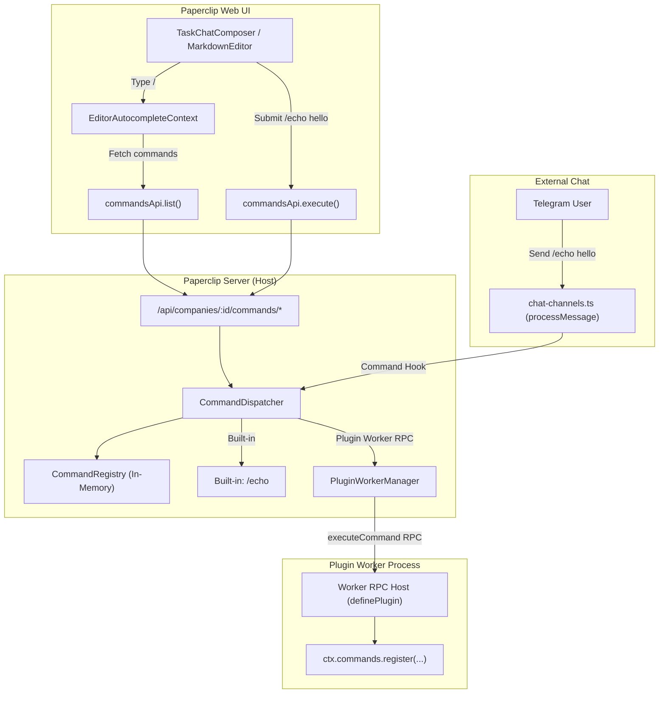

# TOM-17: Shared Command Framework — Implementation Plan (Slice 1)

## Goal Description

Introduce a minimal, versioned vertical slice for the **Shared Command Framework (TOM-17)** in Paperclip. Currently, slash commands are fragmented across hardcoded options in the UI (`/goal`, `/new` in `TaskChatComposer.tsx`) and hardcoded command lists in the external Telegram adapter (`/new`, `/close`, `/status` in `server/src/services/chat-channels.ts`), with no plugin extensibility, no unified host dispatch boundary, and no dynamic autocomplete.

This plan establishes a clean vertical slice:
1. **Versioned Shared Command Declaration & Registry (`packages/shared`)**: `CommandDeclarationV1`, invocation/result envelopes, parsing utilities (`parseSlashCommand`), and schema validation.
2. **Plugin SDK Command Registration (`packages/plugins/sdk`)**: Manifest declaration (`manifest.commands`), worker capability (`ctx.commands.register`), and RPC method (`executeCommand`).
3. **Host Dispatch Boundary & API (`server`)**: `CommandDispatcher` service managing built-in and plugin commands, company isolation, and REST endpoints (`GET /api/companies/:companyId/commands`, `POST /api/companies/:companyId/commands/execute`).
4. **Slash Autocomplete Integration (`ui`)**: `EditorAutocompleteContext` fetching commands dynamically to feed `MarkdownEditor`, with `TaskChatComposer` submit interception.
5. **External Telegram Mapping & Dispatch Hook (`server/src/services/chat-channels.ts`)**: Recognizes registered commands in Telegram messages, executes them via the host dispatch boundary, and delivers responses back to Telegram threads.
6. **Example Command (`/echo`)**: Built-in, deterministic command validating the slice end-to-end without external dependencies.
7. **Focused Tests**: Targeted unit and contract tests across each layer.



---

## User Review Required

> [!IMPORTANT]
> **Control-Plane Invariant & Company Scope**: All command queries and executions are strictly company-scoped (`companyId`). Actor authorization is verified by the host prior to dispatch.
> **Command Precedence**: Built-in control commands (`/status`, `/new`, `/close`, `/goal`) always take precedence over plugin commands to prevent command shadowing or security bypass.
> **Minimal Vertical Slice**: This slice intentionally avoids large UI redesigns or complex multi-argument modal forms. It focuses strictly on single-turn text commands (like `/echo <args>`) to prove the host dispatch boundary, autocomplete, and external Telegram routing.

---

## Open Questions

> [!NOTE]
> 1. **Task Chat Execution Feedback**: When a user runs `/echo <message>` in the UI Task Chat composer, should the result be posted as a visible system note/comment in the task thread (matching how Telegram posts a reply), or shown as a transient banner above the composer?
>    *(Recommendation: Post an external task control publication / system comment to maintain parity between UI and Telegram chat threads).*
> 2. **Telegram Bot Command Synchronization**: When Telegram endpoints run maintenance (`register_commands`), should registered chat commands from the shared registry automatically append to the Telegram Bot command menu via `setMyCommands`?
>    *(Recommendation: Yes, dynamically append compatible registered commands so Telegram clients see them in the pop-up command menu).*

---

## Proposed Changes

Grouped by component layer according to dependency order: `packages/shared` &rarr; `packages/plugins/sdk` &rarr; `server` &rarr; `ui`.

---

### Component 1: Shared Command Declarations & Registry (`packages/shared`)

#### [NEW] `packages/shared/src/types/commands.ts`
Defines the versioned command contract:
```typescript
export interface CommandDeclarationV1 {
  /** Command identifier (no leading slash, e.g. "echo"). Lowercase alphanumeric and hyphens. */
  command: string;
  /** Display title for autocomplete popup. */
  title: string;
  /** Description for autocomplete description. */
  description: string;
  /** Optional usage string, e.g. "/echo <text>". */
  usage?: string;
  /** Allowed execution environments. Default: ["ui_chat", "external_chat"]. */
  contexts?: Array<"ui_chat" | "external_chat">;
  /** Command category. */
  category?: "general" | "task" | "session";
  /** Command origin. */
  source: { type: "built-in" } | { type: "plugin"; pluginId: string };
  /** Optional aliases. */
  aliases?: string[];
}

export interface CommandInvocationContext {
  companyId: string;
  source: "ui_chat" | "external_chat" | "api";
  issueId?: string | null;
  conversationId?: string | null;
  channelId?: string | null;
  actor?: {
    id: string;
    type: "user" | "agent" | "external";
    name?: string | null;
  };
}

export interface CommandExecutionInput {
  command: string;
  args: string;
  context: CommandInvocationContext;
}

export interface CommandExecutionResult {
  success: boolean;
  message?: string | null;
  data?: unknown;
  action?: "reply" | "silent" | "none";
}
```

#### [NEW] `packages/shared/src/commands.ts`
Provides parsing and in-memory registry helpers:
```typescript
import type { CommandDeclarationV1 } from "./types/commands.js";

export function parseSlashCommand(text: string): {
  matched: boolean;
  command: string;
  botHandle: string | null;
  args: string;
} {
  const trimmed = text.trim();
  // Strip relative autolink markdown if emitted by rich text editors
  const normalized = trimmed.replace(/^\[\/([a-z0-9_-]+)\]\(<.*?>\)/i, "/$1");
  const match = /^\/([a-z0-9_-]+)(?:@([a-z0-9_]+))?(?:\s+(.*)|\s*)?$/is.exec(normalized);
  if (!match) {
    return { matched: false, command: "", botHandle: null, args: "" };
  }
  return {
    matched: true,
    command: match[1]!.toLowerCase(),
    botHandle: match[2] ?? null,
    args: match[3]?.trim() ?? "",
  };
}

export class SharedCommandRegistry {
  private commands = new Map<string, CommandDeclarationV1>();

  register(declaration: CommandDeclarationV1): void {
    this.commands.set(declaration.command.toLowerCase(), declaration);
    for (const alias of declaration.aliases ?? []) {
      this.commands.set(alias.toLowerCase(), declaration);
    }
  }

  unregister(command: string): void {
    const existing = this.commands.get(command.toLowerCase());
    if (!existing) return;
    this.commands.delete(existing.command.toLowerCase());
    for (const alias of existing.aliases ?? []) {
      this.commands.delete(alias.toLowerCase());
    }
  }

  get(commandOrAlias: string): CommandDeclarationV1 | null {
    return this.commands.get(commandOrAlias.toLowerCase()) ?? null;
  }

  list(filter?: { context?: "ui_chat" | "external_chat" }): CommandDeclarationV1[] {
    const unique = new Map<string, CommandDeclarationV1>();
    for (const cmd of this.commands.values()) {
      if (filter?.context && cmd.contexts && !cmd.contexts.includes(filter.context)) {
        continue;
      }
      unique.set(cmd.command, cmd);
    }
    return Array.from(unique.values());
  }
}
```

#### [NEW] `packages/shared/src/validators/commands.ts`
Zod schema validation:
```typescript
import { z } from "zod";

export const commandDeclarationV1Schema = z.object({
  command: z.string().regex(/^[a-z0-9_-]+$/).min(1).max(64),
  title: z.string().min(1).max(100),
  description: z.string().min(1).max(500),
  usage: z.string().optional(),
  contexts: z.array(z.enum(["ui_chat", "external_chat"])).optional(),
  category: z.enum(["general", "task", "session"]).optional(),
  source: z.union([
    z.object({ type: z.literal("built-in") }),
    z.object({ type: z.literal("plugin"), pluginId: z.string() }),
  ]),
  aliases: z.array(z.string().regex(/^[a-z0-9_-]+$/)).optional(),
});

export const commandExecutionInputSchema = z.object({
  command: z.string().min(1),
  args: z.string().default(""),
  issueId: z.string().uuid().nullable().optional(),
  conversationId: z.string().uuid().nullable().optional(),
});
```

#### [MODIFY] `packages/shared/src/types/plugin.ts` & `packages/shared/src/validators/plugin.ts`
- Extend `PaperclipPluginManifestV1`: add `commands?: CommandDeclarationV1[];`.
- Extend `paperclipPluginManifestV1Schema`: add `commands: z.array(commandDeclarationV1Schema).optional()`.
- Extend `PLUGIN_CAPABILITIES` in `packages/shared/src/constants.ts`: add `"commands.register"`.
- Re-export new modules from `packages/shared/src/index.ts`, `types/index.ts`, and `validators/index.ts`.

---

### Component 2: Plugin SDK (`packages/plugins/sdk`)

#### [MODIFY] `packages/plugins/sdk/src/protocol.ts`
Add `executeCommand` to RPC contract:
```typescript
export interface ExecuteCommandParams {
  command: string;
  args: string;
  context: CommandInvocationContext;
}

export interface HostToWorkerMethods {
  // Existing methods...
  executeCommand: [params: ExecuteCommandParams, result: CommandExecutionResult];
}
```

#### [MODIFY] `packages/plugins/sdk/src/types.ts`
Expose `ctx.commands` client to plugins:
```typescript
export interface PluginCommandsClient {
  register(
    command: string,
    handler: (input: { args: string; context: CommandInvocationContext }) => Promise<CommandExecutionResult> | CommandExecutionResult,
  ): void;
}

export interface PluginContext {
  // Existing clients...
  commands: PluginCommandsClient;
}
```

#### [MODIFY] `packages/plugins/sdk/src/worker-rpc-host.ts`
Wire command registration and worker dispatch:
- Add `const commandHandlers = new Map<string, CommandHandler>();`.
- In `ctx.commands.register(command, handler)`: register to `commandHandlers`.
- In `handleRequest`:
  ```typescript
  case "executeCommand": {
    const handler = commandHandlers.get(params.command.toLowerCase());
    if (!handler) {
      throw new Error(`No command handler registered for "/${params.command}"`);
    }
    return await handler({ args: params.args, context: params.context });
  }
  ```

---

### Component 3: Server Host Dispatch Boundary (`server`)

#### [NEW] `server/src/services/command-dispatcher.ts`
Host command dispatch boundary managing registration and routing:
```typescript
import { SharedCommandRegistry, type CommandDeclarationV1, type CommandExecutionInput, type CommandExecutionResult } from "@paperclipai/shared";
import type { PluginWorkerManager } from "./plugin-worker-manager.js";
import type { PluginLifecycleManager } from "./plugin-lifecycle.js";
import type { Db } from "@paperclipai/db";

export function createCommandDispatcher(opts: {
  workerManager?: PluginWorkerManager;
  lifecycleManager?: PluginLifecycleManager;
  db?: Db;
}) {
  const registry = new SharedCommandRegistry();
  const builtInHandlers = new Map<string, (input: CommandExecutionInput) => Promise<CommandExecutionResult> | CommandExecutionResult>();

  // Register built-in example command: /echo
  const echoDeclaration: CommandDeclarationV1 = {
    command: "echo",
    title: "Echo",
    description: "Echo message back to the conversation",
    usage: "/echo <message>",
    contexts: ["ui_chat", "external_chat"],
    category: "general",
    source: { type: "built-in" },
  };
  registry.register(echoDeclaration);
  builtInHandlers.set("echo", (input) => ({
    success: true,
    message: input.args ? `Echo: ${input.args}` : "Echo: (empty)",
    data: { echoed: input.args },
    action: "reply",
  }));

  async function executeCommand(input: CommandExecutionInput): Promise<CommandExecutionResult> {
    const cmd = registry.get(input.command);
    if (!cmd) {
      return { success: false, message: `Unknown command "/${input.command}".` };
    }

    // Check context availability (e.g. ui_chat vs external_chat)
    if (cmd.contexts && !cmd.contexts.includes(input.context.source)) {
      return { success: false, message: `Command "/${input.command}" is not available in ${input.context.source}.` };
    }

    if (cmd.source.type === "built-in") {
      const handler = builtInHandlers.get(cmd.command);
      if (!handler) throw new Error(`Missing built-in handler for /${cmd.command}`);
      return await handler(input);
    }

    if (cmd.source.type === "plugin") {
      if (!opts.workerManager) throw new Error("Plugin worker manager unavailable");
      return await opts.workerManager.call(cmd.source.pluginId, "executeCommand", {
        command: cmd.command,
        args: input.args,
        context: input.context,
      });
    }

    throw new Error(`Unsupported command source type`);
  }

  return {
    registry,
    executeCommand,
    listCommands: (filter?: { context?: "ui_chat" | "external_chat" }) => registry.list(filter),
    getCommand: (command: string) => registry.get(command),
  };
}
export type CommandDispatcher = ReturnType<typeof createCommandDispatcher>;
```

#### [NEW] `server/src/routes/commands.ts`
Company-scoped REST endpoints:
```typescript
import { Router } from "express";
import { assertCompanyAccess } from "./authz.js";
import { commandExecutionInputSchema } from "@paperclipai/shared";
import type { CommandDispatcher } from "../services/command-dispatcher.js";
import type { Db } from "@paperclipai/db";

export function commandRoutes(db: Db, dispatcher: CommandDispatcher) {
  const router = Router();

  // GET /api/companies/:companyId/commands - list available commands for autocomplete
  router.get("/companies/:companyId/commands", async (req, res) => {
    await assertCompanyAccess(req, req.params.companyId);
    const commands = dispatcher.listCommands({ context: "ui_chat" });
    res.json(commands);
  });

  // POST /api/companies/:companyId/commands/execute - execute a command from UI
  router.post("/companies/:companyId/commands/execute", async (req, res) => {
    await assertCompanyAccess(req, req.params.companyId);
    const parsed = commandExecutionInputSchema.safeParse(req.body);
    if (!parsed.success) {
      res.status(400).json({ error: parsed.error.message });
      return;
    }

    const result = await dispatcher.executeCommand({
      command: parsed.data.command,
      args: parsed.data.args,
      context: {
        companyId: req.params.companyId,
        source: "ui_chat",
        issueId: parsed.data.issueId,
        conversationId: parsed.data.conversationId,
        actor: {
          id: (req as any).user?.id ?? "unknown",
          type: "user",
        },
      },
    });

    res.json({ data: result });
  });

  return router;
}
```

#### [MODIFY] `server/src/app.ts` & `server/src/routes/index.ts`
- Wire `commandDispatcher` in `server/src/app.ts`.
- Mount `api.use(commandRoutes(db, commandDispatcher));`.
- Pass `commandDispatcher` to chat channels initialization.

---

### Component 4: External Telegram Mapping & Dispatch Hook (`server/src/services/chat-channels.ts`)

#### [MODIFY] `server/src/services/chat-channels.ts`
In `processMessage`:
1. Check incoming message for registered commands via `parseSlashCommand(message.text)`.
2. If matched and registered in `commandDispatcher`:
```typescript
const parsed = parseSlashCommand(message.text);
const registered = parsed.matched ? commandDispatcher.getCommand(parsed.command) : null;

if (registered && registered.contexts?.includes("external_chat") !== false) {
  // Execute via host dispatch boundary
  const result = await commandDispatcher.executeCommand({
    command: parsed.command,
    args: parsed.args,
    context: {
      companyId: endpoint.companyId,
      source: "external_chat",
      channelId: thread.id,
      actor: {
        id: principalResolution.principal.id,
        type: "external",
        name: message.author.fullName,
      },
    },
  });

  if (result.message) {
    if (existingConversation && existingIssue) {
      await stageAuthorizedTaskControlPublication(tx, {
        companyId: endpoint.companyId,
        endpointId: endpoint.id,
        conversationId: existingConversation.id,
        issueId: existingIssue.id,
        idempotencyKey: `control:cmd:${activeDelivery.id}`,
        payload: projectSafeChatPublication({
          classification: "external",
          source: "task_control",
          text: result.message,
        }),
        principalId: principalResolution.principal.id,
      });
    } else {
      await stageProviderEffect(tx, {
        endpoint,
        deliveryId: activeDelivery.id,
        principalId: principalResolution.principal.id,
        providerActionId: `provider_effect:delivery:${activeDelivery.id}`,
        payload: {
          version: 1,
          effect: "thread_message",
          threadId: thread.id,
          text: result.message,
          settleDelivery: true,
          resourceId: resource.id,
        },
        runtimeContext: effectContext,
      });
    }
  }
  return; // Handled! Do not fall through to unknown guidance or task continuation
}
```
3. In `TELEGRAM_COMMANDS` / `register_commands` (maintenance):
   Merge `commandDispatcher.listCommands({ context: "external_chat" })` into Telegram `setMyCommands` payload.

---

### Component 5: UI Slash Autocomplete & Composer (`ui`)

#### [NEW] `ui/src/api/commands.ts`
API client methods:
```typescript
import { api } from "./client";
import type { CommandDeclarationV1, CommandExecutionResult } from "@paperclipai/shared";

export const commandsApi = {
  list: (companyId: string): Promise<CommandDeclarationV1[]> =>
    api.get(`/api/companies/${companyId}/commands`),
  execute: (
    companyId: string,
    payload: { command: string; args: string; issueId?: string; conversationId?: string },
  ): Promise<{ data: CommandExecutionResult }> =>
    api.post(`/api/companies/${companyId}/commands/execute`, payload),
};
```

#### [MODIFY] `ui/src/context/EditorAutocompleteContext.tsx`
Fetch commands from `commandsApi.list` and expose in `slashCommands`:
```typescript
const { data: serverCommands = [] } = useQuery({
  queryKey: selectedCompanyId
    ? ["company-commands", selectedCompanyId]
    : ["company-commands", "__none__"],
  queryFn: () => commandsApi.list(selectedCompanyId!),
  enabled: Boolean(selectedCompanyId),
});

// Map server commands to ActionCommandOption:
const commandOptions: ActionCommandOption[] = serverCommands.map((cmd) => ({
  id: `action:${cmd.command}`,
  kind: "action" as const,
  command: cmd.command,
  name: cmd.title,
  description: cmd.description,
  aliases: [cmd.command, ...(cmd.aliases ?? [])],
}));

// In value:
slashCommands: [
  ...commandOptions,
  ...skillOptions,
  ...routineOptions,
]
```

#### [MODIFY] `ui/src/components/task-chat/TaskChatComposer.tsx`
In `submit()`:
1. Parse command with `parseSlashCommand(submittedBody)`.
2. If matched and not `/goal` or `/new`:
```typescript
const parsedCmd = parseSlashCommand(submittedBody);
if (parsedCmd.matched && serverCommandsMap.has(parsedCmd.command)) {
  try {
    setSubmitting(true);
    const { data } = await commandsApi.execute(selectedCompanyId, {
      command: parsedCmd.command,
      args: parsedCmd.args,
      issueId,
    });
    setBody("");
    editorRef.current?.clear();
    if (draftKey) clearDraft(draftKey);
    // If command returned an error message, display it
    if (!data.success && data.message) {
      setActionError(data.message);
    }
  } catch (err) {
    setActionError(err instanceof Error ? err.message : "Failed to execute command");
  } finally {
    setSubmitting(false);
  }
  return;
}
```

---

## Verification Plan

### Automated Tests
1. **Shared package tests**:
   - `packages/shared/src/validators/commands.test.ts`:
     - Validate `CommandDeclarationV1` schema with valid and invalid values.
     - Validate `parseSlashCommand`: basic command (`/echo test`), with bot suffix (`/echo@mybot test`), without args (`/echo`), with leading/trailing whitespace.
     - Validate `SharedCommandRegistry`: register, duplicate check, alias lookup, list filtering by context.
2. **Plugin SDK tests**:
   - `packages/plugins/sdk/tests/commands.test.ts`:
     - Test `ctx.commands.register("echo", handler)` in plugin worker test harness.
     - Verify RPC round-trip for `executeCommand`.
3. **Server dispatcher & routes tests**:
   - `server/src/__tests__/command-dispatcher.test.ts`:
     - Verify built-in `/echo` execution returns expected message.
     - Verify unknown command returns failure.
     - Verify context filtering (`ui_chat` vs `external_chat`).
   - `server/src/__tests__/command-routes.test.ts`:
     - `GET /api/companies/:companyId/commands` returns 200 with command list.
     - `POST /api/companies/:companyId/commands/execute` with `/echo hello` returns `{ success: true, message: "Echo: hello" }`.
     - Enforces company isolation (401/403 for unauthorized company).
4. **External Telegram hook tests**:
   - `server/src/services/chat-telegram-command-dispatch.test.ts`:
     - Simulate inbound message `/echo test message` and `/echo@bot test message`.
     - Assert `commandDispatcher.executeCommand` is called.
     - Assert response publication is staged.
     - Assert unknown command falls back to existing guidance behavior.
5. **UI Autocomplete tests**:
   - `ui/src/context/EditorAutocompleteContext.test.tsx`:
     - Test that commands from `commandsApi.list` appear as slash command options.
   - Run token gate verification: `node scripts/check-token-gates.mjs`.

### Commands to Run
```bash
# Focused vitest runs for affected suites
npx vitest run packages/shared/src/validators/commands.test.ts
npx vitest run packages/plugins/sdk/tests/commands.test.ts
npx vitest run server/src/__tests__/command-dispatcher.test.ts
npx vitest run server/src/__tests__/command-routes.test.ts
npx vitest run server/src/services/chat-telegram-command-dispatch.test.ts

# Design system token gates
node scripts/check-token-gates.mjs
```

### Manual Verification
1. Open Task Chat in the UI.
2. Type `/` in the composer and verify `/echo` appears in the autocomplete dropdown with "Echo message back to the conversation".
3. Select `/echo`, type `hello world`, and hit Enter.
4. Verify `/echo hello world` executes through the host dispatch boundary and clears the composer.
5. Send `/echo hello from telegram` to a connected Telegram bot. Verify the bot replies with `Echo: hello from telegram`.
